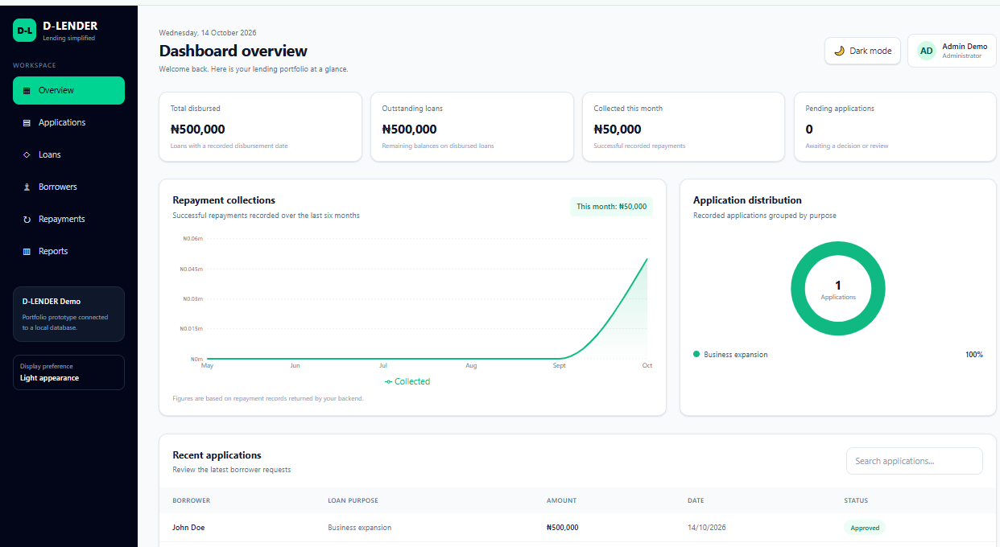
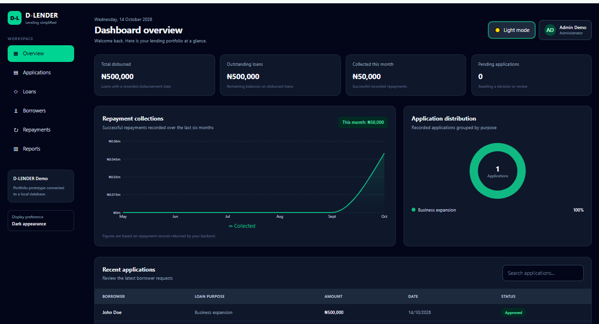
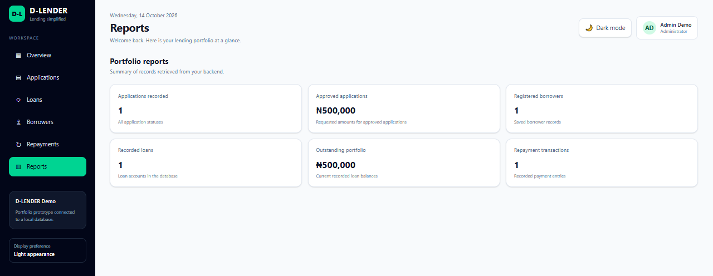

# D-LENDER — Loan Management System

A full-stack web application for loan tracking, disbursement management, repayment monitoring, and financial reporting.

**Built with React, TypeScript, Node.js, Express, and MySQL.**

## Overview

D-LENDER is a web-based loan management system designed to help users monitor loan activity, track repayments, and review outstanding balances through a centralized dashboard.

The project demonstrates full-stack development, REST API integration, dashboard analytics, responsive interface design, and automated build checks using GitHub Actions.

## Key Features

- **Dashboard Analytics:** Monitor total disbursed loans, outstanding balances, monthly collections, and pending applications.
- **Loan Management:** Organize and track loan records.
- **Loan Disbursement:** Support the recording of loan disbursement activity.
- **Repayment Tracking:** Record repayments and monitor outstanding balances.
- **Financial Reporting:** Display key loan performance metrics.
- **Dark Mode:** Switch between light and dark themes, with the selected theme preserved across page refreshes.
- **REST API:** Connect the frontend to the backend through API endpoints.
- **Automated CI:** Run frontend linting, frontend production builds, and backend TypeScript compilation through GitHub Actions.

## Application Screenshots

### Dashboard



### Dashboard — Dark Mode



### Repayment Management



## Technology Stack

### Frontend

- React
- TypeScript
- Vite
- Tailwind CSS
- Recharts

### Backend

- Node.js
- Express
- TypeScript
- MySQL
- mysql2

### Development and Quality Assurance

- Git and GitHub
- GitHub Actions
- ESLint
- npm

## Project Structure

```text
d-lender/
├── .github/
│   └── workflows/
│       └── ci.yml
├── backend/
│   ├── src/
│   ├── package.json
│   └── package-lock.json
├── frontend/
│   ├── src/
│   ├── package.json
│   └── package-lock.json
├── docs/
│   └── screenshots/
│       ├── dashboard.png
│       ├── dashboard-dark-mode.png
│       └── repayment.png
├── .gitignore
└── README.md
```

## Getting Started

### Prerequisites

Install the following before running the application:

- Node.js and npm
- MySQL
- Git

### 1. Clone the repository

```bash
git clone https://github.com/classik7/d-lender.git
cd d-lender
```

### 2. Install frontend dependencies

```bash
cd frontend
npm ci
```

### 3. Install backend dependencies

Open a second terminal from the project root and run:

```bash
cd backend
npm ci
```

### 4. Configure the environment

Create the required local environment configuration files for the frontend and backend.

Configure the backend's MySQL connection and any required application settings using the environment variable names expected by the existing source code.

Do not commit `.env` files, database credentials, API keys, or other secrets to GitHub.

Ensure the required database and schema are available before using features that depend on MySQL.

### 5. Start the backend

From the `backend` directory, run:

```bash
npm run dev
```

### 6. Start the frontend

In a separate terminal, from the `frontend` directory, run:

```bash
npm run dev
```

Open the local URL displayed by Vite in your browser.

## Quality Checks

### Frontend

Run from the `frontend` directory:

```bash
npm ci
npm run lint
npm run build
```

### Backend

Run from the `backend` directory:

```bash
npm ci
npm run build
```

## Continuous Integration

D-LENDER uses GitHub Actions for continuous integration.

The workflow is defined in:

`.github/workflows/ci.yml`

It runs on pushes and pull requests targeting the `main` branch and can also be started manually.

The workflow performs the following checks:

- Checks out the repository.
- Sets up Node.js.
- Installs dependencies using `npm ci`.
- Runs ESLint on the frontend.
- Builds the frontend for production.
- Compiles the backend TypeScript code.

View the repository and workflow:

- **GitHub Repository:** https://github.com/classik7/d-lender
- **GitHub Actions:** https://github.com/classik7/d-lender/actions

The current workflow validates code quality and builds. Production deployment is not yet configured.

## Security Considerations

- Keep secrets and environment files out of version control.
- Use environment variables for sensitive configuration.
- Validate user input on the backend.
- Apply appropriate authentication and authorization controls.
- Secure database access and credentials before production deployment.

## Project Status

D-LENDER is under active development. The frontend and backend build checks have previously passed in GitHub Actions. Production hosting and automated deployment remain separate steps.

## Author

**Awelewa Johnson Oluwaseun**

GitHub: [classik7](https://github.com/classik7)

Project Repository: [D-LENDER](https://github.com/classik7/d-lender)